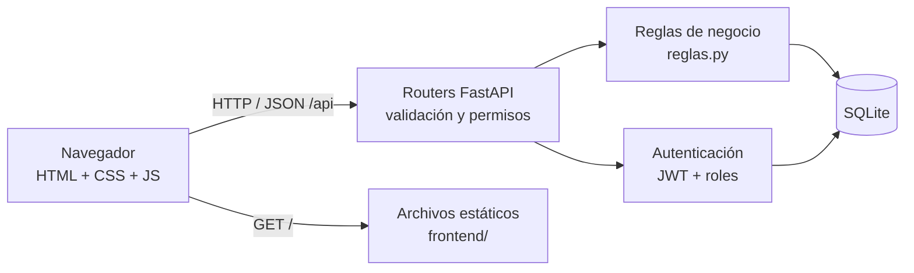
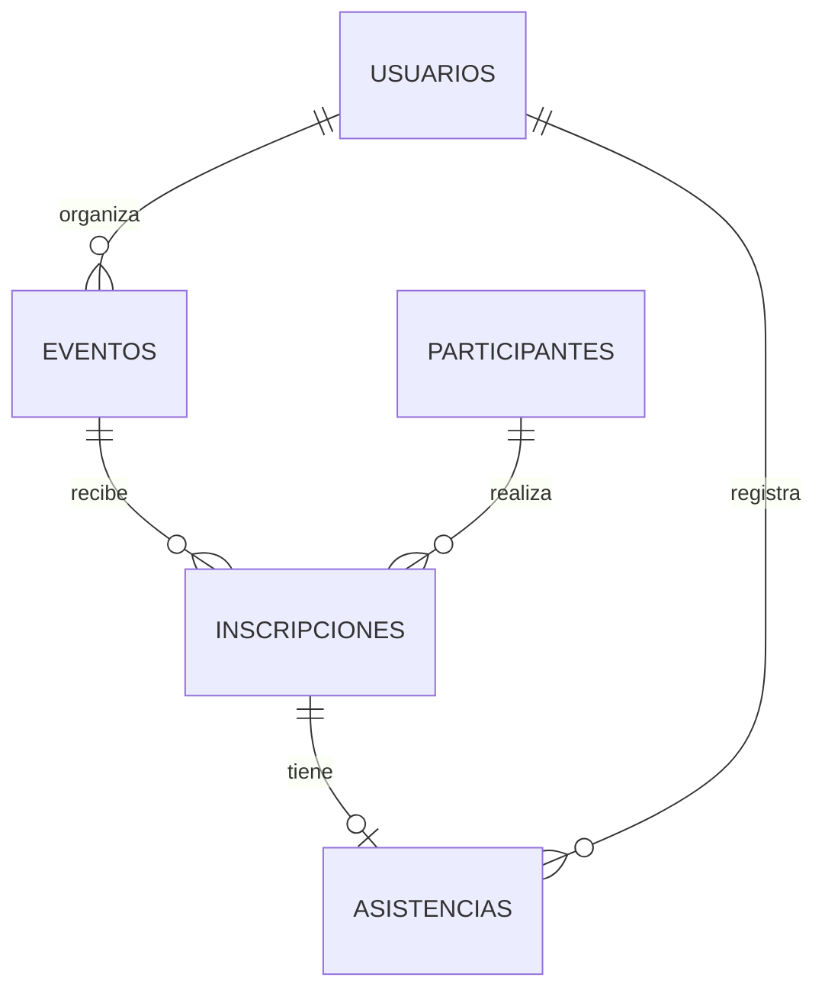

# Eventos Académicos - Organización de eventos y actividades académicas

Proyecto Final 04 (guía PF-04). Aplicación web para publicar actividades académicas, inscribir participantes, controlar cupos, registrar asistencia y consolidar información.

## 1. Información general

| Campo | Valor |
|---|---|
| Problema seleccionado | Organización de eventos y actividades académicas de una institución educativa |
| Integrante | Juan David Velasquez (trabajo individual) |
| Contribución | Requisitos, diseño, backend, frontend, pruebas, evidencias y documentación. Desarrollado con asistencia de una herramienta de IA (Claude Code), bajo revisión y aprobación del autor |
| Asignatura | Aplicaciones y Servicios Web - Tecnología en Desarrollo de Software |
| Fecha de entrega | 25 de noviembre de 2026 |
| Repositorio | https://github.com/juandavidvelasquezgomez/trabajo-final-SAW |

## 2. Descripción del sistema

**Problema:** las actividades se anuncian por varios medios y las inscripciones llegan por formularios o mensajes sueltos. No se conoce el número real de inscritos, los cupos se descontrolan, hay duplicados y es difícil consolidar la asistencia.

**Solución:** una aplicación web (interfaz + API REST + base de datos) que cubre CA-01 a CA-06.

| Actor | Qué puede hacer |
|---|---|
| Participante (sin cuenta) | Consultar eventos, inscribirse, cancelar su inscripción, obtener su constancia |
| Organizador | Crear y gestionar **sus** eventos, ver inscritos, registrar asistencia |
| Coordinación | Todo lo del organizador sobre **todos** los eventos, y el consolidado |

**Restricciones del alcance:** sin pagos, videoconferencias, SMS/WhatsApp, certificados firmados ni integración institucional.

**Extensiones incluidas:** constancia de asistencia imprimible (**sin firma digital**) y códigos QR (generación; se leen con la cámara del celular).

Detalle completo: [docs/requisitos.md](docs/requisitos.md).

## 3. Requisitos y alcance

- **Método:** análisis de la guía y cuestionario de 20 preguntas (eventos, inscripción y cupos, asistencia, permisos y reportes).
- **Evidencia de entrevista:** la sesión con el docente **no se realizó**. Las respuestas las dio el autor y están marcadas como **supuestos pendientes de confirmación del docente** ([sección 3](docs/requisitos.md#3-entrevista-respondida-por-el-autor)).
- **Reglas de negocio** RN-01 a RN-16, **requisitos funcionales** RF-01 a RF-20 y no funcionales RNF-01 a RNF-11, priorizados con MoSCoW.
- **Historias de usuario** HU-01 a HU-07 con criterios de aceptación: [requisitos.md, sección 7](docs/requisitos.md#7-historias-de-usuario-y-criterios-de-aceptación).

Reglas principales: el cupo nunca se supera; una inscripción activa por persona y evento; sin cruces de horario; duración máxima de 8 horas; asistencia registrable hasta 2 horas después del fin y corregible hasta 24 horas.

## 4. Arquitectura, API y modelo de datos





| Tecnología | Justificación |
|---|---|
| Python + FastAPI | Lenguaje usado en el curso; valida entradas con tipos y genera documentación interactiva (`/docs`) |
| SQLite | Sin servidor que instalar; transacciones para controlar cupos; igual en cualquier equipo |
| HTML, CSS y JavaScript puro | Sin compilación ni Node.js; un solo servidor entrega interfaz y API |
| JWT (PyJWT) y `scrypt` | Sesiones firmadas y contraseñas con hash |
| segno | Generación de códigos QR |

- Diseño completo (componentes, modelo de datos, endpoints, permisos): [docs/diseno.md](docs/diseno.md)
- Prototipo de interfaz: [docs/prototipos/prototipo-interfaz.html](docs/prototipos/prototipo-interfaz.html)
- Capturas de la aplicación: carpeta [evidencias/](evidencias/)

## 5. Configuración del entorno

**Requisitos:** Windows, macOS o Linux con Python 3.12 o superior (probado con 3.14) y Git. Comandos en PowerShell desde la raíz del repositorio.

```powershell
cd backend
python -m venv .venv
.\.venv\Scripts\python.exe -m pip install -r requirements-dev.txt
Copy-Item ..\.env.example ..\.env
```

**Variables de entorno** (archivo `.env` en la raíz; nunca se sube a Git):

| Variable | Obligatoria | Uso |
|---|---|---|
| `SECRET_KEY` | Sí (32 caracteres o más) | Firma de tokens y códigos de constancia |
| `DATABASE_PATH` | No | Ruta de la base SQLite (por defecto `backend/db/eventos.db`) |
| `SEED_PASSWORD` | No | Contraseña de las cuentas de prueba; si está vacía se genera y se muestra una vez |
| `URL_PUBLICA` | No | Dirección que se codifica en los QR |

Generar la clave:

```powershell
.\.venv\Scripts\python.exe -c "import secrets; print(secrets.token_urlsafe(48))"
```

**Base de datos con datos ficticios y arranque:**

```powershell
.\.venv\Scripts\python.exe db\seed.py --reiniciar
.\.venv\Scripts\python.exe -m uvicorn app.main:app --reload
```

- Aplicación: http://127.0.0.1:8000/
- Documentación interactiva de la API: http://127.0.0.1:8000/docs
- Cuentas de prueba (contraseña = `SEED_PASSWORD`): `coordinacion@ejemplo.test`, `ana.torres@ejemplo.test`, `luis.mora@ejemplo.test`
- Participante de ejemplo con constancia: `laura.gomez@ejemplo.test`, documento `1000000001`

`seed.py` crea eventos finalizado, publicados (uno con cupo lleno), borrador y cancelado, con fechas relativas al día en que se ejecuta.

Para demostrar la asistencia en vivo, `db\preparar_demo.py` agrega un evento **en curso** con tres inscritos:

```powershell
.\.venv\Scripts\python.exe db\preparar_demo.py
```

## 6. Servicios web implementados

Prefijo `/api`. "Personal" = organizador dueño del evento o coordinación.

| Método | Ruta | Descripción | Acceso | Requisito |
|---|---|---|---|---|
| GET | `/salud` | Estado del servicio | Público | - |
| POST | `/auth/login` | Iniciar sesión | Público | RF-16 |
| GET | `/auth/me` | Usuario autenticado | Personal | RF-16 |
| GET | `/eventos` | Catálogo (filtros `tipo`, `desde`, `hasta`) | Público | RF-04 |
| GET | `/eventos/{id}` | Detalle | Público / personal | RF-05 |
| POST | `/eventos` | Crear evento (borrador) | Personal | RF-01 |
| PUT | `/eventos/{id}` | Editar | Personal | RF-03 |
| PATCH | `/eventos/{id}/estado` | Publicar o cancelar | Personal | RF-02, RF-03 |
| GET | `/panel/eventos` | Eventos que gestiona el usuario | Personal | RF-13 |
| GET | `/organizadores` | Lista de organizadores | Coordinación | RF-01 |
| POST | `/eventos/{id}/inscripciones` | Inscribirse | Público | RF-06, RF-08 |
| POST | `/eventos/{id}/inscripciones/cancelar` | Cancelar inscripción | Público (correo y documento) | RF-09 |
| POST | `/inscripciones/consultar` | Consultar mis inscripciones | Público (correo y documento) | RF-07 |
| GET | `/eventos/{id}/inscripciones` | Inscritos y asistencia | Personal | RF-07, RF-11 |
| PATCH | `/inscripciones/{id}` | Cancelar una inscripción | Personal | RF-09 |
| POST | `/eventos/{id}/inscripciones/en-el-momento` | Inscribir y marcar presente | Personal | RF-15 |
| PUT | `/eventos/{id}/asistencia/{inscripcion_id}` | Registrar o corregir asistencia | Personal | RF-10, RF-17 |
| POST | `/eventos/{id}/asistencia/lote` | Asistencia de varios | Personal | RF-10 |
| GET | `/consolidado` | Consolidado con filtros | Coordinación | RF-12, RF-14 |
| POST | `/constancias` | Constancias de un participante | Público (correo y documento) | RF-19 |
| GET | `/constancias/{codigo}` | Verificar constancia | Público | RF-19 |
| GET | `/constancias/{codigo}/qr` | QR de verificación | Público | RF-20 |
| GET | `/eventos/{id}/qr` | QR de un evento publicado | Público | RF-20 |

### Ejemplos

`POST /api/eventos/2/inscripciones`

```json
{ "nombre_completo": "Camila Vargas", "correo": "camila.vargas@ejemplo.test",
  "documento": "1000000102", "rol": "estudiante", "programa": "Desarrollo de Software" }
```

Respuesta `201`:

```json
{ "id": 29, "evento_id": 2, "estado": "activa", "en_el_momento": false, "cupos_disponibles": 24,
  "participante": { "id": 13, "nombre_completo": "Camila Vargas", "correo": "camila.vargas@ejemplo.test" } }
```

Error (todos usan este formato):

```json
{ "error": { "codigo": "CUPO_AGOTADO", "mensaje": "El evento no tiene cupos disponibles.", "detalles": [] } }
```

| HTTP | Significado | Ejemplos de código |
|---|---|---|
| 401 | Sin sesión o token vencido | `NO_AUTENTICADO`, `TOKEN_EXPIRADO`, `CREDENCIALES_INVALIDAS` |
| 403 | Sin permiso | `SIN_PERMISO` |
| 404 | No existe | `EVENTO_NO_ENCONTRADO`, `CONSTANCIA_NO_VALIDA` |
| 409 | Conflicto con una regla | `CUPO_AGOTADO`, `INSCRIPCION_DUPLICADA`, `CRUCE_DE_HORARIO` |
| 422 | Datos inválidos | `DATOS_INVALIDOS`, `FECHA_EN_PASADO`, `DURACION_EXCEDIDA` |
| 429 | Demasiados intentos de ingreso | `DEMASIADOS_INTENTOS` |

**Validaciones:** tipos estrictos, fechas ISO 8601, correos y documentos normalizados, campos desconocidos rechazados. Contrato completo en `/docs`.

## 7. Pruebas y evidencias

Documento con pasos, datos, resultados y capturas: [docs/pruebas-funcionales.md](docs/pruebas-funcionales.md).

| ID | Prueba | Requisitos | HTTP | Estado |
|---|---|---|---|---|
| P01 | Registro y publicación válida | RF-01, RF-02 | 201, 200 | Aprobada |
| P02 | Actividad con datos inválidos | RF-01 | 422 | Aprobada |
| P03 | Catálogo y detalle | RF-04, RF-05 | 200 | Aprobada |
| P04 | Evento inexistente | RF-05 | 404 | Aprobada |
| P05 | Inscripción válida | RF-06, RF-07 | 201 | Aprobada |
| P06 | Inscripción inválida | RF-06 | 422 | Aprobada |
| P07 | Cupo agotado | RF-08 | 409 | Aprobada |
| P08 | Inscripción duplicada | RF-08 | 409 | Aprobada |
| P09 | Sin autorización | RF-13 | 401, 403 | Aprobada |
| P10 | Asistencia | RF-10, RF-11 | 200 | Aprobada |
| P11 | Consolidado y consistencia | RF-12, RF-14 | 200 | Aprobada |
| P12 | Integración completa | CA-01 a CA-06 | 201, 200 | Aprobada |

Además, 286 pruebas automatizadas (opcionales según la guía):

```powershell
cd backend
.\.venv\Scripts\python.exe -m pytest
```

- Matriz de trazabilidad: [docs/trazabilidad.md](docs/trazabilidad.md)

## 8. Control de versiones

- **Flujo:** una rama por tarea, commits descriptivos y pull request hacia `main` con propósito, cambios, pruebas y requisitos.
- **Pull requests:** [lista completa](https://github.com/juandavidvelasquezgomez/trabajo-final-SAW/pulls?q=is%3Apr) y [resumen en la trazabilidad](docs/trazabilidad.md#pull-requests).
- **Aportes:** trabajo individual; Juan David Velasquez es el autor de los commits (los de la entrega final registran además a Claude como coautor). Al ser un solo integrante no aplica la revisión cruzada entre integrantes.

## 9. Conclusiones y limitaciones

**Cumplimiento:** las condiciones CA-01 a CA-06 están implementadas y demostradas con las pruebas P01 a P12.

**Dificultades verificadas y soluciones**

| Dificultad | Solución |
|---|---|
| Dos inscripciones simultáneas podían superar el cupo | Transacción `BEGIN IMMEDIATE` y triggers en la base |
| La misma persona podía registrarse con otro formato | Normalización de correo y documento, restricciones únicas |
| El detalle mostraba el texto "null" sin imagen | Se descartan los nodos vacíos antes de dibujar |
| El navegador conservaba scripts viejos | Cabecera `Cache-Control: no-cache` |
| Los filtros aceptaban rangos invertidos | Validación en servidor e interfaz con el mismo mensaje |
| Un borrador con la fecha vencida no se podía reprogramar | Solo los eventos publicados que ya iniciaron bloquean sus fechas |

**Limitaciones**
- Los requisitos son supuestos del autor, pendientes de confirmación del docente.
- El participante se identifica con correo y documento, sin verificación por correo.
- El bloqueo por intentos fallidos vive en memoria (se reinicia con el servidor).
- Pensado para un solo servidor; no se desplegó en la nube.
- La constancia no tiene firma digital y deja de ser válida si se cambia `SECRET_KEY`.
- Sin probar todavía en un celular físico ni la lectura de los QR desde otro dispositivo; en pantallas pequeñas las tablas se deslizan en horizontal.

**Mejoras futuras:** lista de espera, estados de tardanza o excusa, interfaz en inglés y firma digital de constancias.
