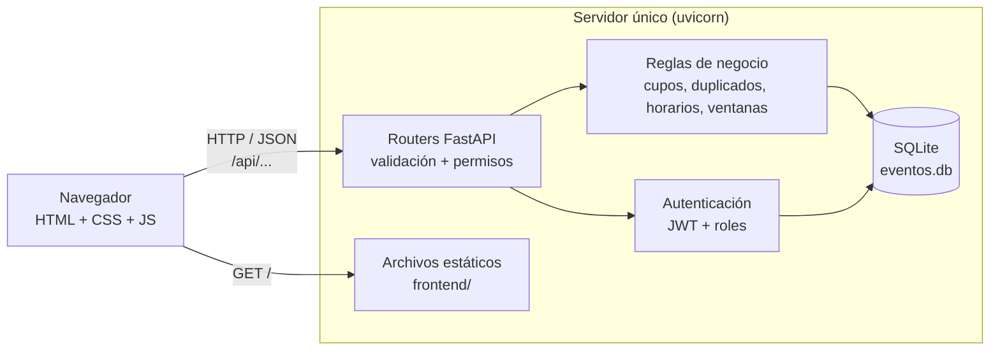
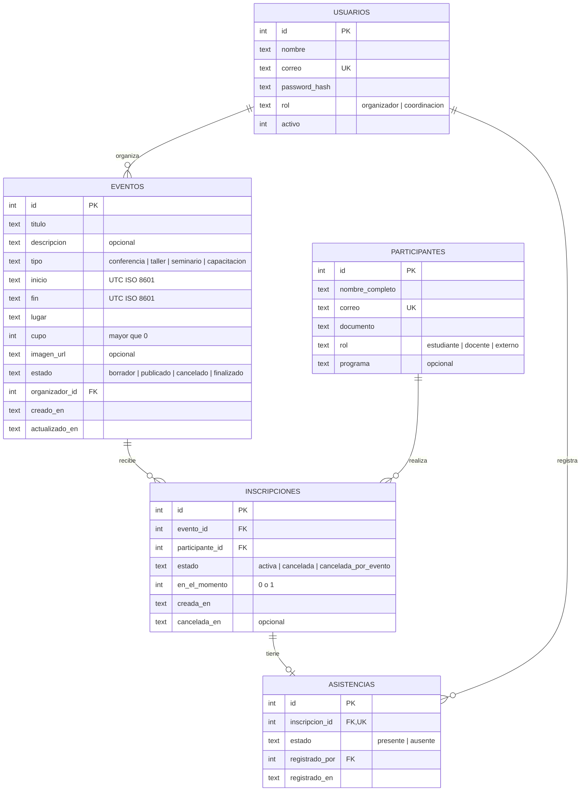

# Diseño - Organización de eventos y actividades académicas

**Proyecto:** PF-04 - Aplicaciones y Servicios Web
**Autor:** Juan David Velasquez (trabajo individual)
**Base:** [`requisitos.md`](requisitos.md) (reglas RN, requisitos RF/RNF, historias HU). Los requisitos siguen pendientes de confirmación del docente; si cambian, este diseño se ajusta.

---

## 1. Decisiones técnicas

| Capa | Tecnología | Justificación |
|---|---|---|
| Backend / API REST | **Python 3 + FastAPI** | Es el lenguaje usado en el curso. Genera documentación interactiva de la API (`/docs`) que sirve también para ejecutar las pruebas funcionales. Valida entradas con modelos tipados (RNF-02). |
| Base de datos | **SQLite** (módulo `sqlite3` de la biblioteca estándar) | Es un archivo local: sin servidor que instalar, igual en el equipo de escritorio y en el portátil (RNF-08). Admite transacciones, necesarias para el control de cupos (RNF-06). |
| Frontend | **HTML + CSS + JavaScript puro** | Sin Node.js ni compilación. El mismo servidor entrega las páginas, así que se ejecuta con un solo comando. |
| Autenticación | Token **JWT** firmado (PyJWT) y contraseñas con **hash `scrypt`** de la biblioteca estándar | Pocas dependencias externas; sin texto plano (RNF-11). |
| Pruebas | Pruebas funcionales documentadas con la interfaz `/docs` de la API y el navegador | Lo que pide la Actividad 6; no se exige automatización. |

**Dependencias externas previstas:** `fastapi`, `uvicorn`, `PyJWT`, `python-dotenv`. Todo lo demás es biblioteca estándar. Se verificará al instalar que todas funcionen con la versión de Python de ambos equipos.

**Un solo proceso:** `uvicorn` sirve la API bajo `/api/...`, la documentación en `/docs` y la interfaz web en `/`. No hay problemas de CORS ni configuración de dos servidores.

## 2. Arquitectura



| Componente | Responsabilidad |
|---|---|
| **Frontend** | Mostrar catálogo, detalle, formularios, panel del personal y consolidados; llamar a la API; mostrar errores al usuario. No contiene reglas de negocio: solo ayudas de validación. |
| **Routers** | Recibir solicitudes, validar el formato con modelos, comprobar el rol y delegar en las reglas. |
| **Reglas de negocio** | Un único módulo (`reglas.py`) con las reglas RN: así se aplican igual desde la interfaz o desde `/docs` (la guía exige que el servidor proteja los datos aunque no se use la interfaz). |
| **Base de datos** | Persistencia y restricciones de integridad (`CHECK`, `UNIQUE`, claves foráneas) como segunda línea de defensa. |
| **Autenticación** | Inicio de sesión, emisión y verificación del token, comprobación de rol. |

### Estructura del repositorio

```text
backend/
  app/
    main.py            # crea la app, monta la API y los archivos estáticos
    config.py          # variables de entorno y constantes (zona horaria, plazos)
    db.py              # conexión SQLite y manejo de transacciones
    auth.py            # hash de contraseñas, JWT, dependencias de rol
    errores.py         # formato único de errores y manejadores
    schemas.py         # modelos de entrada y salida
    reglas.py          # reglas de negocio RN-01..RN-14
    routers/
      auth.py  eventos.py  inscripciones.py  asistencia.py  consolidado.py
  db/
    schema.sql         # creación de tablas, restricciones e índices
    seed.py            # datos de prueba ficticios (usuarios, eventos, participantes)
  requirements.txt
frontend/
  index.html  evento.html  login.html  panel.html  asistencia.html  consolidado.html
  css/estilos.css
  js/api.js  js/catalogo.js  js/evento.js  js/panel.js  js/asistencia.js  js/consolidado.js
docs/  evidencias/  .env.example  README.md
```

## 3. Modelo de datos



### Restricciones clave
- `eventos`: `CHECK (cupo > 0)`, `CHECK (fin > inicio)`, `tipo` y `estado` con lista de valores permitidos.
- `participantes.correo` único y normalizado (minúsculas, sin espacios) antes de guardar.
- `inscripciones`: **índice único parcial** sobre `(evento_id, participante_id)` donde `estado = 'activa'`. Garantiza RN-02 aunque falle la validación del servidor.
- `asistencias.inscripcion_id` único: una fila de asistencia por inscripción.

### Decisiones de modelado
- **Fechas:** se guardan en UTC (ISO 8601) y se muestran en hora de Colombia (`America/Bogota`), según RNF-10.
- **Cupos disponibles** no se guarda: se calcula como `cupo − inscripciones activas`, para que nunca se desincronice (CA-02, prueba 11).
- **Asistencia "ausente" por defecto:** solo se guarda una fila cuando alguien la registra. Un inscrito sin fila cuenta como `ausente`. Una corrección de `presente` a `ausente` actualiza la misma fila.
- **Estado `finalizado`:** antes de cada consulta o escritura relacionada con eventos, una función marca como `finalizado` los `publicado` cuyo `fin` ya pasó (RF-18). No requiere un proceso aparte.
- **Participante reutilizable:** si el correo ya existe, se reutiliza el registro; si los datos difieren, se rechaza con conflicto para no sobrescribir datos de otra persona.
- **Borrado:** no se borran inscripciones ni asistencias; cambian de estado. Los eventos no se borran, se cancelan.

## 4. Servicios web (API REST)

Prefijo `/api`. Formato JSON. Autenticación: cabecera `Authorization: Bearer <token>` en los endpoints del personal.

| # | Método | Ruta | Acceso | Descripción | Éxito | RF |
|---|---|---|---|---|---|---|
| 1 | POST | `/auth/login` | Público | Inicio de sesión (correo + contraseña); devuelve el token | 200 | RF-16 |
| 2 | GET | `/auth/me` | Personal | Datos del usuario autenticado | 200 | RF-16 |
| 3 | GET | `/eventos` | Público | Catálogo de eventos publicados con cupos disponibles; filtros `tipo`, `desde`, `hasta` | 200 | RF-04 |
| 4 | GET | `/eventos/{id}` | Público (publicados) / personal (todos) | Detalle de un evento | 200 | RF-05 |
| 5 | POST | `/eventos` | Organizador, coordinación | Crea un evento en `borrador` | 201 | RF-01 |
| 6 | PUT | `/eventos/{id}` | Dueño o coordinación | Edita datos de un evento | 200 | RF-03 |
| 7 | PATCH | `/eventos/{id}/estado` | Dueño o coordinación | Publicar o cancelar (`publicado`, `cancelado`) | 200 | RF-02, RF-03 |
| 8 | POST | `/eventos/{id}/inscripciones` | Público | Inscripción del participante | 201 | RF-06, RF-08 |
| 9 | POST | `/eventos/{id}/inscripciones/cancelar` | Público | Cancela la inscripción (correo + documento) | 200 | RF-09 |
| 10 | GET | `/inscripciones?correo=&documento=` | Público | Consulta las inscripciones de un participante (exige ambos datos) | 200 | RF-07 |
| 11 | GET | `/eventos/{id}/inscripciones` | Dueño o coordinación | Lista de inscritos con su asistencia | 200 | RF-07, RF-11 |
| 12 | PATCH | `/inscripciones/{id}` | Dueño o coordinación | Cambia el estado de una inscripción una vez iniciado el evento | 200 | RF-09 |
| 13 | POST | `/eventos/{id}/inscripciones/en-el-momento` | Dueño o coordinación | Inscribe y marca presente en un solo paso | 201 | RF-15 |
| 14 | PUT | `/eventos/{id}/asistencia/{inscripcion_id}` | Dueño o coordinación | Registra o corrige la asistencia (`presente`/`ausente`) | 200 | RF-10, RF-17 |
| 15 | POST | `/eventos/{id}/asistencia/lote` | Dueño o coordinación | Registra asistencia de varios inscritos | 200 | RF-10 |
| 16 | GET | `/consolidado` | Coordinación | Totales y detalle por evento; filtros `desde`, `hasta`, `tipo`, `estado`, `organizador_id` | 200 | RF-12, RF-14 |
| 17 | GET | `/organizadores` | Coordinación | Lista de organizadores para asignar al crear un evento | 200 | RF-01 |

"Dueño" = el organizador asignado al evento (RN-07).

### 4.1 Ejemplos

**Crear evento** - `POST /api/eventos`
```json
{
  "titulo": "Taller de Python",
  "tipo": "taller",
  "inicio": "2026-12-10T14:00:00-05:00",
  "fin": "2026-12-10T17:00:00-05:00",
  "lugar": "Aula 301",
  "cupo": 30,
  "descripcion": "Introducción práctica a Python",
  "organizador_id": 2
}
```
Respuesta `201`: el evento con su `id`, `estado: "borrador"` y `cupos_disponibles: 30`. `organizador_id` solo lo puede indicar la coordinación; para un organizador se ignora y se usa el propio.

**Inscribirse** - `POST /api/eventos/5/inscripciones`
```json
{
  "nombre_completo": "Laura Gómez",
  "correo": "laura.gomez@ejemplo.test",
  "documento": "1000000001",
  "rol": "estudiante",
  "programa": "Desarrollo de Software"
}
```
Respuesta `201`:
```json
{ "id": 41, "evento_id": 5, "estado": "activa", "cupos_disponibles": 29 }
```

**Registrar asistencia** - `PUT /api/eventos/5/asistencia/41`
```json
{ "estado": "presente" }
```

### 4.2 Formato de errores

Todos los errores usan la misma estructura y nunca incluyen rastros internos ni datos sensibles (RNF-03):

```json
{ "error": { "codigo": "CUPO_AGOTADO", "mensaje": "El evento no tiene cupos disponibles.", "detalles": [] } }
```

| HTTP | Cuándo | Códigos de ejemplo |
|---|---|---|
| 401 | Sin sesión, token inválido o expirado | `NO_AUTENTICADO`, `TOKEN_EXPIRADO` |
| 403 | Rol o propiedad insuficiente | `SIN_PERMISO` |
| 404 | Recurso inexistente | `EVENTO_NO_ENCONTRADO`, `INSCRIPCION_NO_ENCONTRADA` |
| 409 | Conflicto con el estado actual | `CUPO_AGOTADO`, `INSCRIPCION_DUPLICADA`, `CRUCE_DE_HORARIO`, `EVENTO_NO_ABIERTO`, `EVENTO_YA_INICIADO`, `DATOS_PARTICIPANTE_EN_CONFLICTO` |
| 422 | Datos inválidos o regla de dominio incumplida | `DATOS_INVALIDOS`, `FECHA_EN_PASADO`, `DURACION_EXCEDIDA`, `CUPO_MENOR_A_INSCRITOS`, `VENTANA_ASISTENCIA_CERRADA`, `PARTICIPANTE_NO_INSCRITO` |

## 5. Cómo se aplican las reglas de negocio

| Regla | Dónde se aplica |
|---|---|
| RN-01 Cupo | `reglas.py` dentro de una **transacción** `BEGIN IMMEDIATE`: se cuentan las inscripciones activas y se inserta sin soltar el bloqueo. Dos solicitudes simultáneas no pueden superar el cupo (RNF-06). |
| RN-02 Sin duplicados | Validación en `reglas.py` + índice único parcial en la base de datos. |
| RN-03 Solo `publicado` | `reglas.py` al inscribir. |
| RN-04 Cierre al iniciar | `reglas.py`: rechaza si `ahora ≥ inicio`, salvo el endpoint 13 (en el momento) mientras el evento esté en curso. |
| RN-05 Cancelación libera cupo | Al pasar la inscripción a `cancelada`, deja de contar como activa; el cupo se calcula siempre desde las activas. |
| RN-06 Asistencia solo de inscritos | El endpoint 14 exige una inscripción `activa`; el 13 la crea en el mismo paso. |
| RN-07 Propiedad | Dependencia de seguridad: coordinación pasa siempre; el organizador solo si `organizador_id` coincide, si no `403`. |
| RN-08 Cupo ≥ inscritos | `reglas.py` al editar el evento. |
| RN-09 Fechas y duración | Validación del modelo de entrada + `CHECK (fin > inicio)` en la base de datos. |
| RN-10 Sin cruces de horario | Consulta de solapamiento (`inicio_A < fin_B` y `inicio_B < fin_A`) sobre las inscripciones activas del participante. |
| RN-11 Ventanas de asistencia | Registro: desde `inicio` hasta `fin + 2 h`. Corrección: hasta `fin + 24 h`. Constantes en `config.py`. |
| RN-12 Estados | Transiciones permitidas validadas en el endpoint 7; `finalizado` lo marca el sistema. |
| RN-13 Cancelar evento | Al cancelar, sus inscripciones activas pasan a `cancelada_por_evento` en una sola transacción. |
| RN-14 Token diario | El token lleva como caducidad la **próxima 00:00 de `America/Bogota`**. Al vencer se responde `401 TOKEN_EXPIRADO` y hay que iniciar sesión de nuevo. |

## 6. Control de acceso

| Endpoint | Público | Organizador | Coordinación |
|---|---|---|---|
| 1, 3, 4*, 8, 9, 10 | Sí | Sí | Sí |
| 2, 5, 17 | No | Sí (17 no) | Sí |
| 6, 7, 11, 12, 13, 14, 15 | No | Solo sus eventos | Todos |
| 16 | No | No | Sí |

\* El detalle de un evento en `borrador` o de otro organizador solo lo ve el personal con permiso. Para el público, un evento no publicado responde `404`, para no revelar su existencia.

Los endpoints públicos de consulta de inscripciones (10) y cancelación (9) exigen **correo y documento** coincidentes, porque los participantes no tienen cuenta (RN-05). Si los datos no coinciden, la respuesta es la misma que si no existiera la inscripción, para no revelar si el correo está registrado.

## 7. Interfaz (recorridos y prototipos)

### 7.1 Pantallas

| Pantalla | Actor | Función |
|---|---|---|
| `index.html` Catálogo | Participante | Lista de eventos publicados con cupos; filtro por tipo y fecha. |
| `evento.html` Detalle | Participante | Datos del evento, cupos y formulario de inscripción; cancelar inscripción. |
| `login.html` | Personal | Inicio de sesión. |
| `panel.html` Panel | Personal | Mis eventos (o todos si es coordinación); crear, editar, publicar, cancelar. |
| `asistencia.html` | Personal | Lista de inscritos de un evento; marcar presente/ausente; inscribir en el momento. |
| `consolidado.html` | Coordinación | Totales y detalle por evento con filtros. |

### 7.2 Prototipos

```text
CATÁLOGO                                       DETALLE E INSCRIPCIÓN
+--------------------------------------+       +--------------------------------------+
| Eventos académicos      [Ingresar]   |       | < Volver        Taller de Python     |
| Tipo [todos v]  Desde [____]         |       | Taller · 10 dic 2026 · 14:00-17:00   |
|--------------------------------------|       | Aula 301 · Cupos: 12 de 30           |
| Taller de Python        taller       |       |--------------------------------------|
| 10 dic · 14:00   Cupos: 12/30 [Ver]  |       | Nombre   [__________________]        |
| Charla de IA            conferencia  |       | Correo   [__________________]        |
| 12 dic · 10:00   Cupos: 0/80  AGOTADO|       | Documento[__________________]        |
+--------------------------------------+       | Rol [estudiante v] Programa [____]   |
                                               |              [ Inscribirme ]         |
                                               | ¿Ya te inscribiste? [Cancelar]       |
                                               +--------------------------------------+

ASISTENCIA (personal)                          CONSOLIDADO (coordinación)
+--------------------------------------+       +--------------------------------------+
| Taller de Python · Aula 301          |       | Desde[__] Hasta[__] Tipo[v] Estado[v]|
| Registro abierto hasta 19:00         |       |--------------------------------------|
|--------------------------------------|       | Eventos: 8  Inscritos: 210           |
| Laura Gómez      [Presente][Ausente] |       | Asistentes: 164                      |
| Carlos Ruiz      [Presente][Ausente] |       |--------------------------------------|
| ...                                  |       | Evento       Cupo Insc. Asist.  %    |
| [Inscribir en el momento]            |       | Taller Py.    30   18    15    83%   |
+--------------------------------------+       +--------------------------------------+
```

### 7.3 Recorrido principal (flujo completo exigido en la sustentación)

1. El organizador inicia sesión y **crea** un evento en `borrador`; luego lo **publica**.
2. El participante abre el **catálogo**, ve el evento con sus cupos y se **inscribe**.
3. Con el cupo agotado o con una inscripción duplicada, la interfaz muestra el error devuelto por la API y no cambia nada.
4. Cuando el evento inicia, el organizador abre **asistencia**, marca a los presentes (o inscribe a alguien en el momento).
5. La coordinación abre el **consolidado** y comprueba que cupo, inscritos y asistentes coinciden.

## 8. Configuración y datos de prueba

- **`.env`** (local, nunca se sube): `SECRET_KEY`, `DATABASE_PATH`. **`.env.example`** con valores de ejemplo sin secretos.
- **Base de datos:** `schema.sql` crea las tablas; `seed.py` carga usuarios (un organizador y una coordinación), participantes y eventos **ficticios**, para poder reproducir las pruebas en cualquier equipo.
- **Ejecución:** instalar dependencias, crear la base con `seed.py` y arrancar `uvicorn`. Los comandos exactos se documentarán en el `README.md` al implementarlo.

## 9. Correspondencia con los requisitos

| Condición | Requisitos | Endpoints | Pantallas |
|---|---|---|---|
| CA-01 | RF-01, RF-02, RF-03, RF-13, RF-16 | 1, 2, 5, 6, 7, 17 | login, panel |
| CA-02 | RF-04, RF-05, RF-18 | 3, 4 | catálogo, detalle |
| CA-03 | RF-06, RF-07, RF-15 | 8, 10, 11, 13 | detalle, asistencia |
| CA-04 | RF-08, RF-09 | 8, 9, 12 | detalle |
| CA-05 | RF-07, RF-10, RF-11, RF-13, RF-15, RF-17 | 11, 13, 14, 15 | asistencia |
| CA-06 | RF-12, RF-14, RF-16 | 16 | consolidado |

## 10. Decisiones abiertas y riesgos

- **Compatibilidad de versiones:** se confirmará, al instalar, que `fastapi` y `uvicorn` funcionan con la versión de Python de ambos equipos. Si no, se fija una versión de Python compatible en el `README.md`.
- **Seguridad del participante sin cuenta:** correo + documento es una verificación débil, aceptable para este proyecto académico. En producción haría falta una verificación por correo.
- **Cambios de los requisitos:** si el docente modifica reglas, se actualizan `requisitos.md`, este documento y la matriz de trazabilidad.
