# Pruebas funcionales (Actividad 6)

**Proyecto:** PF-04 - Organización de eventos y actividades académicas · **Ejecutó:** Juan David Velasquez
**Fechas de ejecución:** 24/11/2026 (P01 a P12) y 25/11/2026 (repetición de P04a, P09b, P09c y extensiones)
**Entorno:** Windows 11, Python 3.14, aplicación en `http://127.0.0.1:8000`, base SQLite con datos ficticios.

**Resultado:** las 12 pruebas mínimas quedaron **aprobadas**. Además hay una suite automatizada de 286 pruebas (no exigida por la guía) que también pasa.

## Cómo reproducirlas

1. Preparar el entorno según el [README](../README.md#5-configuración-del-entorno).
2. Cargar datos: `python db/seed.py --reiniciar` (desde `backend/`).
3. Arrancar: `python -m uvicorn app.main:app` y abrir `http://127.0.0.1:8000/`.
4. Cuentas: `coordinacion@ejemplo.test`, `ana.torres@ejemplo.test`, `luis.mora@ejemplo.test` (contraseña: `SEED_PASSWORD` del archivo `.env`).

**Notas sobre las evidencias**
- Las capturas se tomaron con dos cuentas temporales ("Oscar Organizador", rol organizador, y "Elena Coordinadora", rol coordinación). Al reproducir, se usan las cuentas de ejemplo equivalentes (Ana Torres y la coordinación).
- Los identificadores (`id`) cambian según los datos cargados. En la ejecución original, el evento de prueba "Taller de Integración Web" fue el `id` 8.
- Las pruebas P01, P05, P07, P08, P10, P11 y P12 usan **el mismo evento**, así se demuestra el flujo completo.
- Las capturas tomadas el 24/11 son anteriores a las extensiones: no muestran el enlace "Constancias" ni el código QR, y usan textos como "1 cupos" o nombres internos de campo (`nombre_completo`) que se corrigieron el 25/11. El comportamiento probado no cambió.
- Las capturas con una franja oscura superior incluyen un rótulo añadido al capturar, con la URL, la petición, el código HTTP y la hora reales. En las demás, la URL y el código se indican en este documento.
- La columna "automatizada" indica la prueba de `backend/tests/` que verifica el mismo comportamiento y su código HTTP.

## Resumen

| ID | Prueba | Requisitos | Método y ruta | HTTP | Estado |
|---|---|---|---|---|---|
| P01 | Registro y publicación de actividad válida | RF-01, RF-02 | `POST /api/eventos`, `PATCH /api/eventos/{id}/estado` | 201, 200 | Aprobada |
| P02 | Creación con datos inválidos | RF-01, RNF-02 | `POST /api/eventos` | 422 | Aprobada |
| P03 | Consulta de catálogo y detalle | RF-04, RF-05 | `GET /api/eventos`, `GET /api/eventos/{id}` | 200 | Aprobada |
| P04 | Evento inexistente | RF-05, RNF-03 | `GET /api/eventos/99999` | 404 | Aprobada |
| P05 | Inscripción válida | RF-06, RF-07 | `POST /api/eventos/{id}/inscripciones` | 201 | Aprobada |
| P06 | Inscripción con datos inválidos | RF-06, RNF-02 | `POST /api/eventos/{id}/inscripciones` | 422 | Aprobada |
| P07 | Cupo agotado | RF-08, RN-01 | `POST /api/eventos/{id}/inscripciones` | 409 | Aprobada |
| P08 | Inscripción duplicada | RF-08, RN-02 | `POST /api/eventos/{id}/inscripciones` | 409 | Aprobada |
| P09 | Gestión sin autorización | RF-13, RF-16 | `GET .../inscripciones`, `GET /api/consolidado` | 401, 403 | Aprobada |
| P10 | Registro y consulta de asistencia | RF-10, RF-11 | `PUT /api/eventos/{id}/asistencia/{insc}` | 200 | Aprobada |
| P11 | Consolidado y consistencia | RF-12, RF-14 | `GET /api/consolidado` | 200 | Aprobada |
| P12 | Integración interfaz - API - base de datos | CA-01 a CA-06 | Flujo completo | 201, 200 | Aprobada |

---

## P01 - Registro y publicación de una actividad válida

- **Requisitos:** RF-01, RF-02 (CA-01)
- **Condiciones iniciales:** sesión de organizador; sin eventos propios.
- **Pasos:** Panel → completar "Nuevo evento" → **Guardar y publicar** → abrir el Catálogo.
- **Datos de entrada:** título "Taller de Integración Web", tipo taller, inicio unos minutos después de la hora actual, duración 1 h, lugar "Aula 402", cupo 3.
- **Resultado esperado:** el evento se guarda, queda `publicado` y aparece en el catálogo con 3 cupos.
- **Resultado obtenido:** mensaje "Evento creado y publicado"; en el panel 0/3 inscritos y estado Publicado; visible en el catálogo.
- **HTTP:** `POST /api/eventos` 201; `PATCH /api/eventos/{id}/estado` 200 · **Estado:** Aprobada
- **Automatizada:** `test_eventos.py::test_publicar_hace_visible_el_evento_con_sus_cupos`

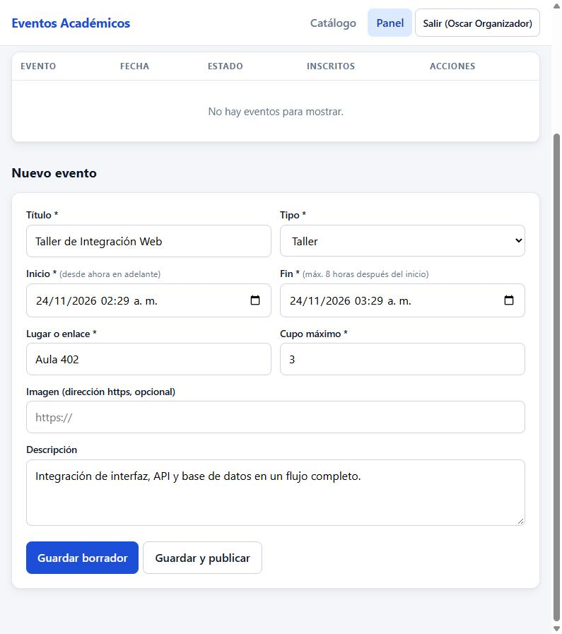
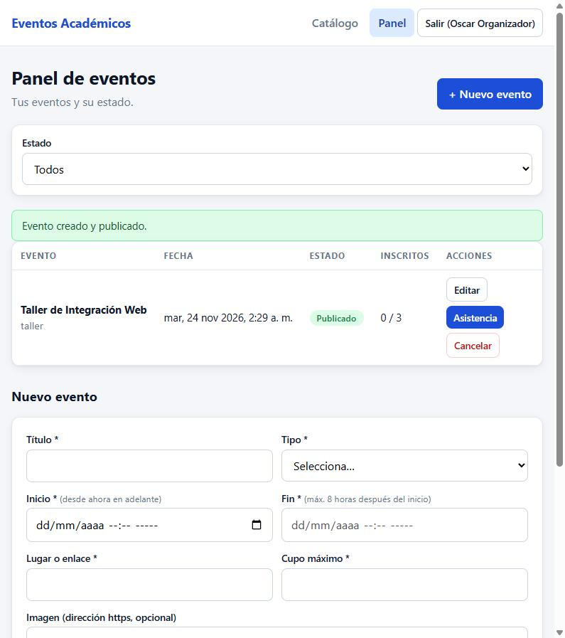
Visible en el catálogo: ver la captura de P03a.

## P02 - Creación de actividad con datos inválidos

- **Requisitos:** RF-01, RNF-02 (CA-01)
- **Condiciones iniciales:** sesión de organizador; un evento en la tabla.
- **Pasos:** Panel → escribir un título formado solo por espacios, completar el resto → **Guardar borrador**.
- **Datos de entrada:** título `"      "`, tipo seminario, inicio mañana, duración 1 h, lugar "Aula 1", cupo 10.
- **Resultado esperado:** rechazo con mensaje claro y **nada** guardado.
- **Resultado obtenido:** "Los datos enviados no son válidos. titulo: Debe tener entre 3 y 150 caracteres." La tabla sigue con un solo evento.
- **HTTP:** 422 `DATOS_INVALIDOS` · **Estado:** Aprobada
- **Automatizada:** `test_eventos.py::test_crear_evento_con_datos_invalidos_no_guarda_nada`

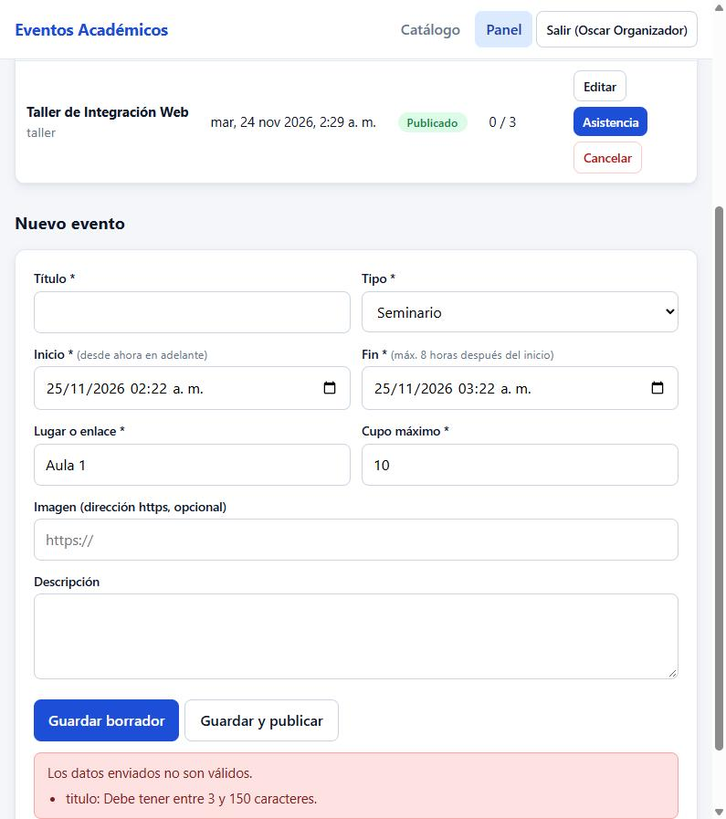

## P03 - Consulta de catálogo y detalle

- **Requisitos:** RF-04, RF-05 (CA-02)
- **Condiciones iniciales:** eventos publicados en la base.
- **Pasos:** abrir `/index.html` → **Ver detalle** del evento de prueba (`/evento.html?id=8`).
- **Datos de entrada:** ninguno.
- **Resultado esperado:** datos reales de la base y cupos coherentes con las inscripciones.
- **Resultado obtenido:** catálogo con tipo, fecha, lugar y cupos; detalle con organizador y "3 cupos disponibles de 3".
- **HTTP:** 200 · **Estado:** Aprobada
- **Automatizada:** `test_eventos.py::test_catalogo_ordenado_y_con_filtros`

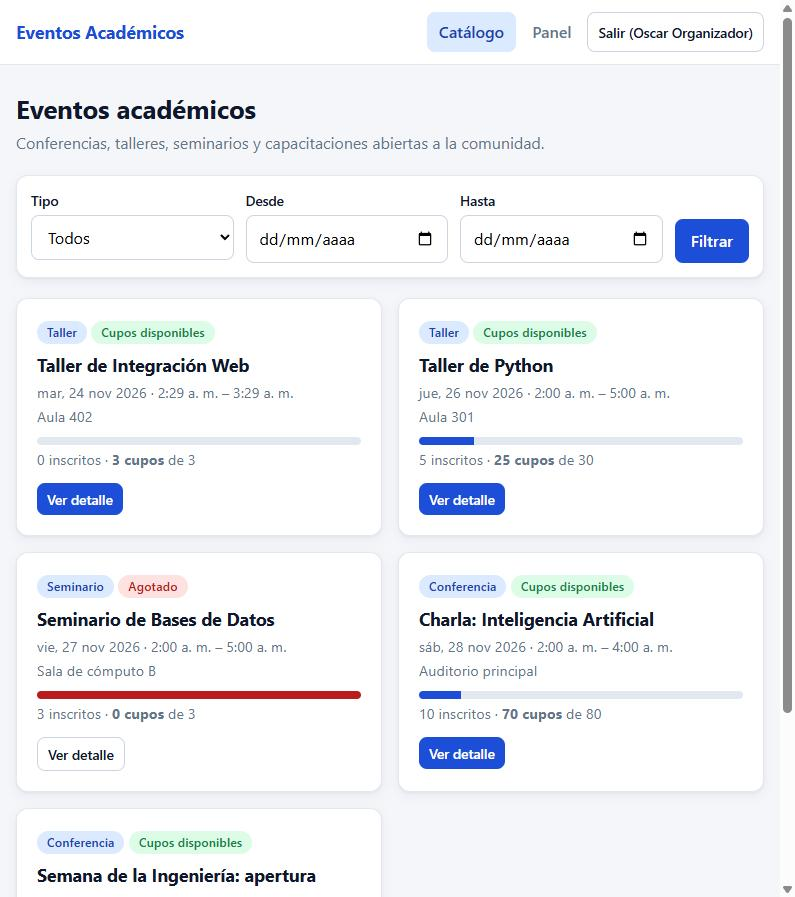
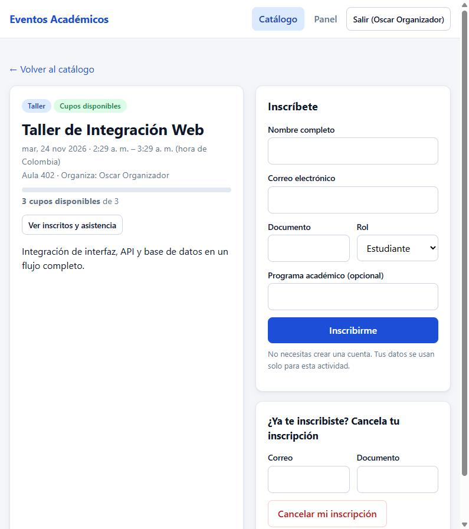

## P04 - Consulta de un evento inexistente

- **Requisitos:** RF-05, RNF-03 (CA-02)
- **Condiciones iniciales:** no existe un evento con `id` 99999.
- **Pasos:** abrir `/evento.html?id=99999` y luego `/api/eventos/99999`.
- **Datos de entrada:** `id = 99999`.
- **Resultado esperado:** error controlado, sin detalles internos.
- **Resultado obtenido:** la interfaz muestra "El evento no existe o no está disponible"; la API responde `{"error":{"codigo":"EVENTO_NO_ENCONTRADO",...}}`.
- **HTTP:** 404 · **Estado:** Aprobada
- **Automatizada:** `test_validaciones.py::test_recurso_inexistente_y_metodo_no_permitido`

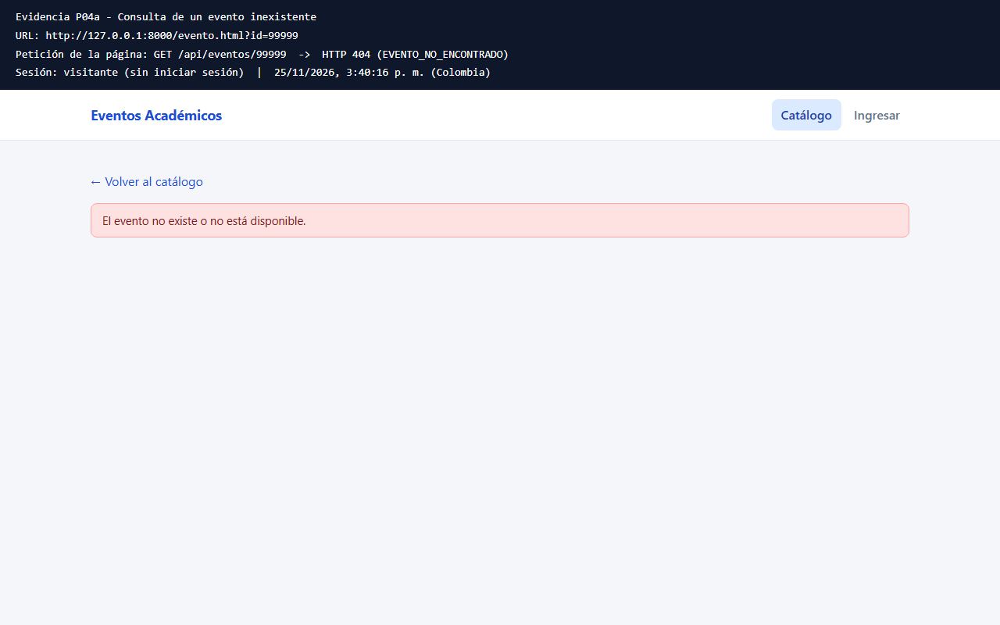
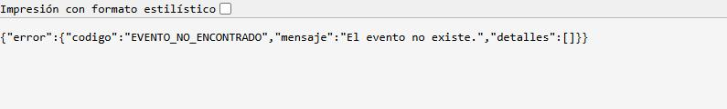

## P05 - Inscripción válida de un participante

- **Requisitos:** RF-06, RF-07 (CA-03)
- **Condiciones iniciales:** evento publicado, sin iniciar, con 3 cupos; visitante sin sesión.
- **Pasos:** detalle del evento → completar "Inscríbete" → **Inscribirme**. Verificar en la lista del personal y con `POST /api/inscripciones/consultar` (cuerpo con correo y documento).
- **Datos de entrada:** Camila Vargas, `camila.vargas@ejemplo.test`, documento 1000000102, estudiante.
- **Resultado esperado:** inscripción guardada, cupos de 3 a 2, recuperable.
- **Resultado obtenido:** "Inscripción confirmada. Quedan 2 cupos"; aparece en la lista del organizador y en la consulta de la API.
- **HTTP:** 201 (inscripción), 200 (consultas) · **Estado:** Aprobada
- **Automatizada:** `test_inscripciones.py::test_inscripcion_valida_se_guarda_y_se_puede_consultar`

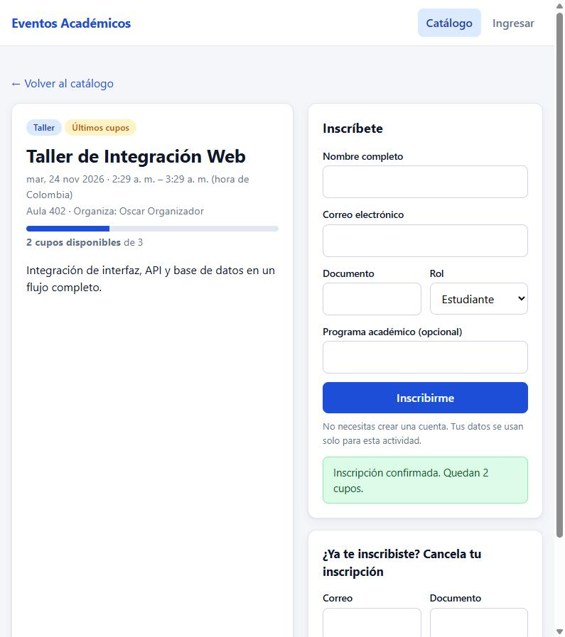
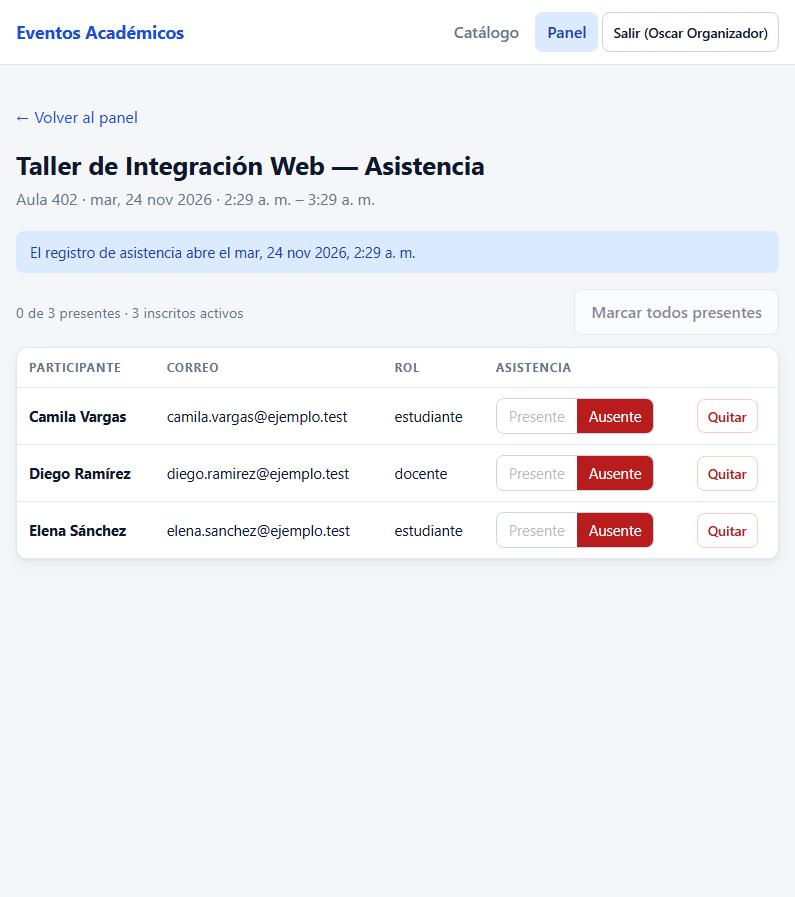
La consulta por API se capturó de nuevo el 25/11 desde `/docs`, con la misma persona inscrita en el "Taller de Python" de los datos de ejemplo.

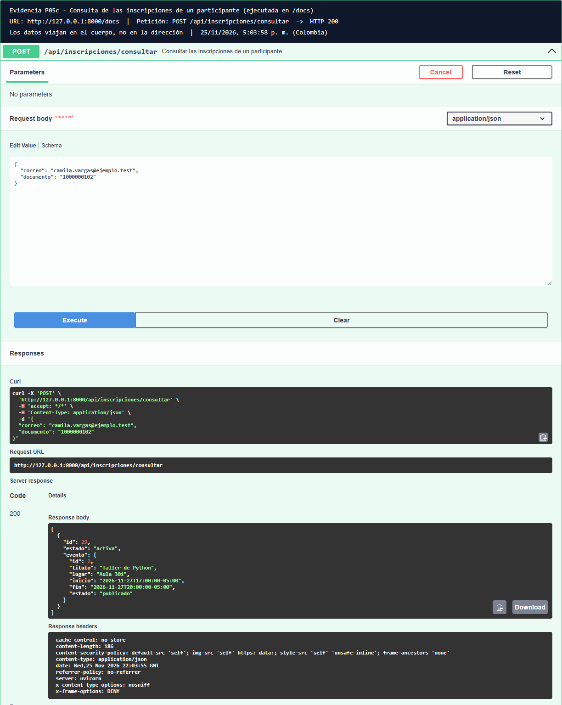

## P06 - Inscripción con datos inválidos

- **Requisitos:** RF-06, RNF-02 (CA-03)
- **Condiciones iniciales:** 2 cupos disponibles.
- **Pasos:** completar el formulario con datos que el navegador deja pasar pero el servidor no.
- **Datos de entrada:** nombre "Juan123", correo `juan.perez@ejemplo.test`, documento "12 34".
- **Resultado esperado:** rechazo del servidor con el motivo; sin cambios.
- **Resultado obtenido:** dos errores (nombre y documento); siguen 2 cupos; esa persona no existe en la base (ver P12b).
- **HTTP:** 422 `DATOS_INVALIDOS` · **Estado:** Aprobada
- **Automatizada:** `test_inscripciones.py::test_inscripcion_con_datos_invalidos_se_rechaza_sin_guardar_nada`

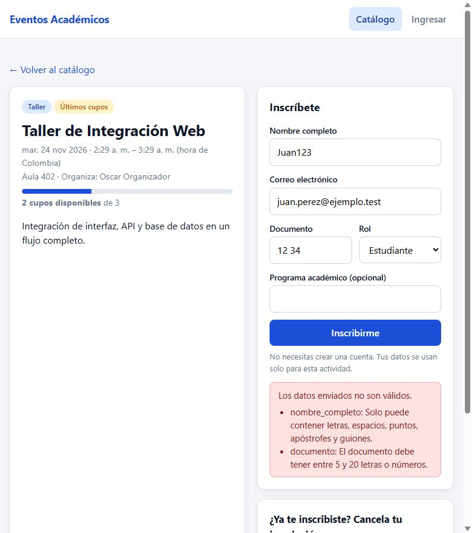

## P07 - Intento de inscripción con cupo agotado

- **Requisitos:** RF-08, RN-01, RNF-06 (CA-04)
- **Condiciones iniciales:** evento con 1 cupo libre; la página del participante ya está abierta.
- **Pasos:** mientras la página aún muestra 1 cupo, otra solicitud toma el último; después se envía el formulario.
- **Nota:** se simuló esta carrera para mostrar el rechazo **del servidor**. En el uso normal la interfaz bloquea el botón cuando no hay cupos.
- **Datos de entrada:** Fabián Torres, `fabian.torres@ejemplo.test`, documento 1000000105.
- **Resultado esperado:** rechazo; el cupo se conserva y no se guarda nada.
- **Resultado obtenido:** "El evento no tiene cupos disponibles"; el evento queda Agotado (3/3) y Fabián no existe en la base.
- **HTTP:** 409 `CUPO_AGOTADO` · **Estado:** Aprobada
- **Automatizada:** `test_inscripciones.py::test_cupo_agotado_se_rechaza_y_el_cupo_se_conserva` y `test_concurrencia_nunca_supera_el_cupo` (25 solicitudes simultáneas, cupo 5: entran exactamente 5)

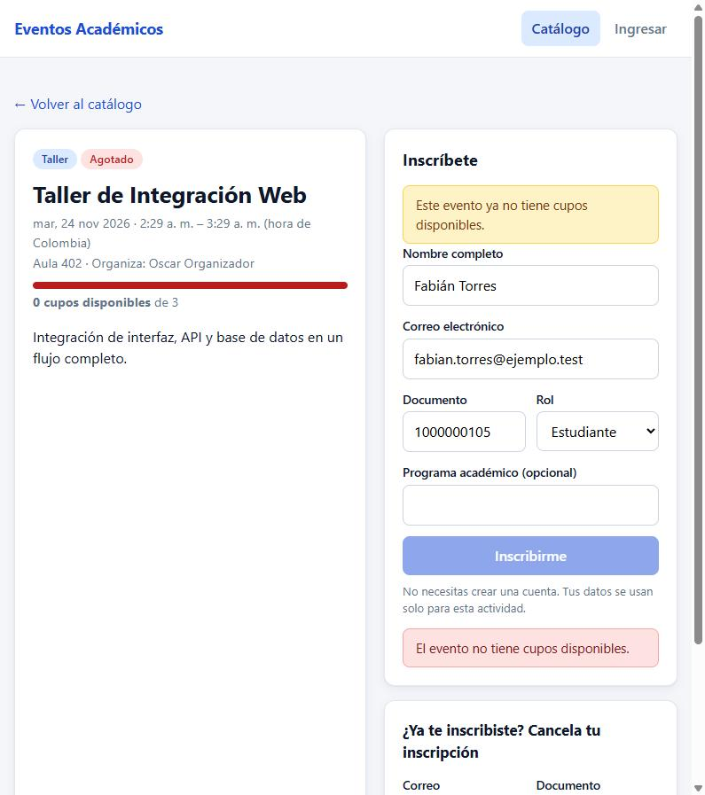

## P08 - Intento de inscripción duplicada

- **Requisitos:** RF-08, RN-02 (CA-04)
- **Condiciones iniciales:** Camila Vargas ya está inscrita.
- **Pasos:** inscribir de nuevo a la misma persona con otro formato.
- **Datos de entrada:** " CAMILA.Vargas@Ejemplo.TEST ", documento "1.000.000.102".
- **Resultado esperado:** rechazo, porque los datos se normalizan antes de comparar.
- **Resultado obtenido:** "El participante ya tiene una inscripción activa en este evento"; los cupos no cambian.
- **HTTP:** 409 `INSCRIPCION_DUPLICADA` · **Estado:** Aprobada
- **Automatizada:** `test_inscripciones.py::test_la_normalizacion_evita_duplicados_disfrazados`

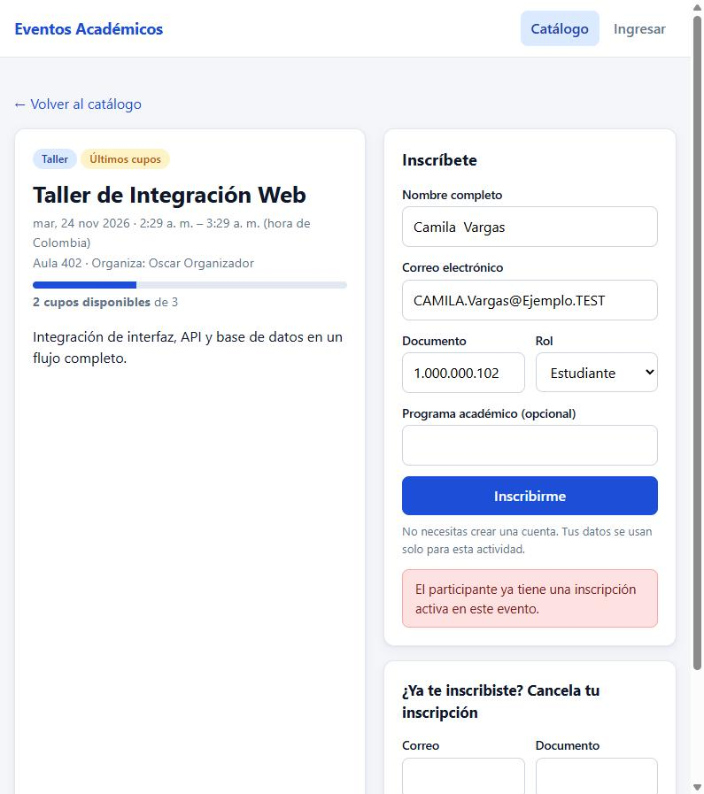

## P09 - Gestión de evento o asistencia sin autorización

- **Requisitos:** RF-13, RF-16, RN-07 (CA-01, CA-05)
- **Condiciones iniciales:** (a) sin sesión; (b, c) sesión de un organizador que no es dueño del evento 2.
- **Pasos:** (a) abrir `/api/eventos/8/inscripciones`; (b) abrir `/asistencia.html?id=2`; (c) abrir `/consolidado.html`.
- **Resultado esperado:** operación impedida.
- **Resultado obtenido:** (a) "Debes iniciar sesión para realizar esta acción"; (b) "No tienes permiso para gestionar este evento"; (c) redirección al panel con "No tienes permiso para ver esa página".
- **HTTP:** (a) 401 `NO_AUTENTICADO`; (b) 403 `SIN_PERMISO`; (c) 403 `SIN_PERMISO` · **Estado:** Aprobada
- **Automatizada:** `test_asistencia.py::test_permisos_de_asistencia`, `test_consolidado.py::test_solo_la_coordinacion_accede`

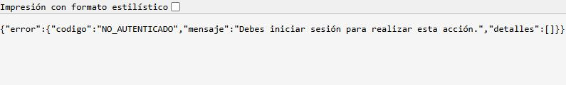
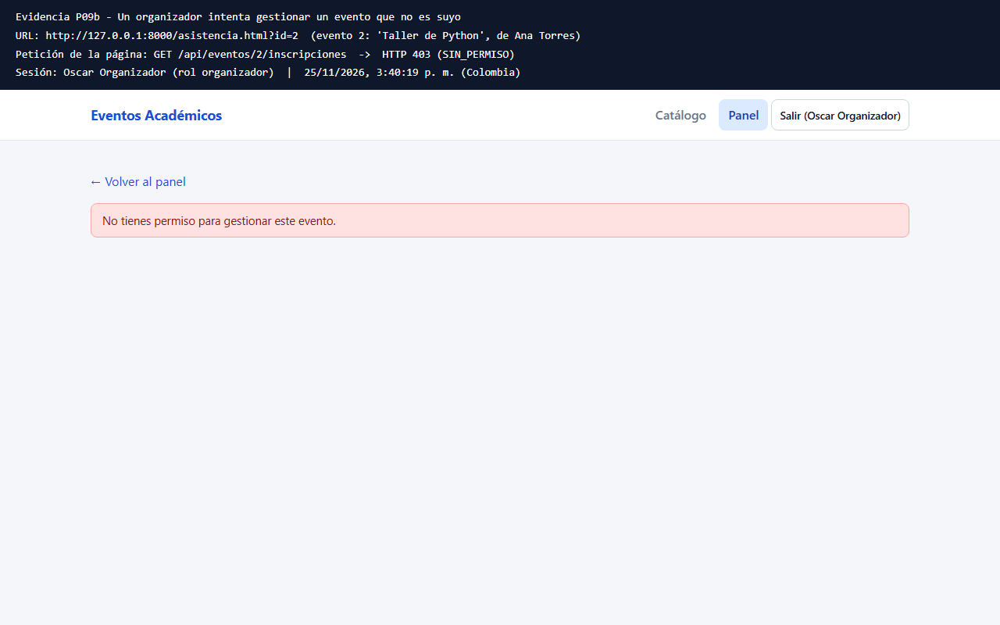
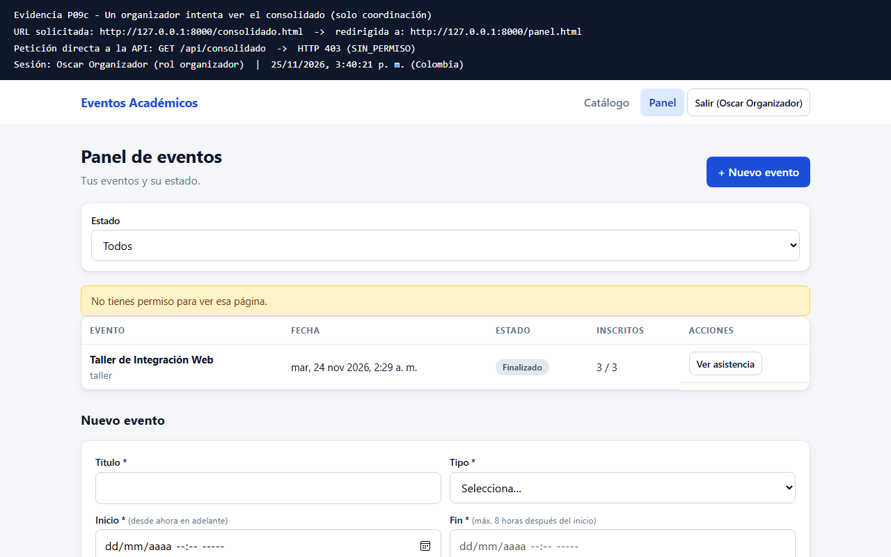

## P10 - Registro y consulta de asistencia

- **Requisitos:** RF-10, RF-11, RN-06, RN-11 (CA-05)
- **Condiciones iniciales:** el evento ya inició; 3 inscritos.
- **Pasos:** Panel → **Asistencia** → marcar **Presente** a Camila Vargas y Diego Ramírez.
- **Resultado esperado:** asistencia guardada y asociada a evento y participante.
- **Resultado obtenido:** "2 de 3 presentes"; Elena Sánchez queda ausente. La base registra quién y cuándo (P12b).
- **HTTP:** `PUT /api/eventos/{id}/asistencia/{insc}` 200 · **Estado:** Aprobada
- **Automatizada:** `test_asistencia.py::test_registrar_asistencia_la_asocia_al_evento_y_al_participante`

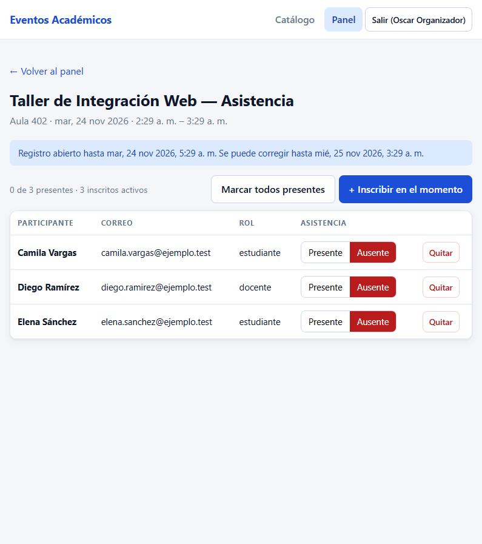
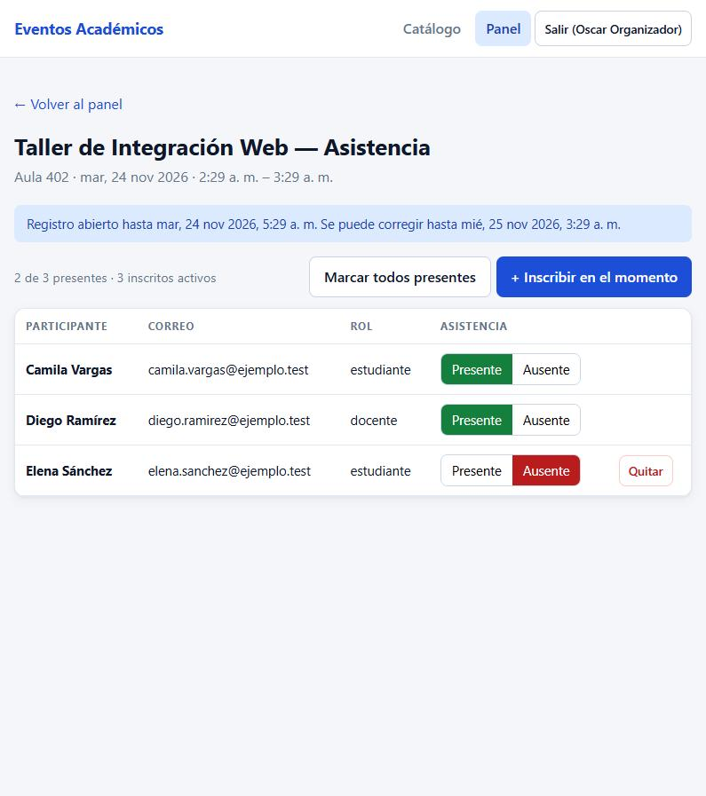

## P11 - Información consolidada y consistencia

- **Requisitos:** RF-12, RF-14 (CA-06)
- **Condiciones iniciales:** sesión de coordinación; asistencia registrada.
- **Pasos:** Consolidado → filtrar por el día del evento. Luego filtrar un rango pasado (historial).
- **Datos de entrada:** desde = hasta = 24/11/2026; historial: 01/01/2020 a 20/11/2026.
- **Resultado esperado:** cupo, inscritos, disponibles y asistentes coherentes.
- **Resultado obtenido:** cupo 3, inscritos 3, disponibles 0, asistentes 2 (66,7 %), igual que en P10 y en la base.
- **HTTP:** 200 · **Estado:** Aprobada
- **Automatizada:** `test_consolidado.py::test_totales_y_detalle_son_coherentes_con_las_inscripciones_y_la_asistencia`

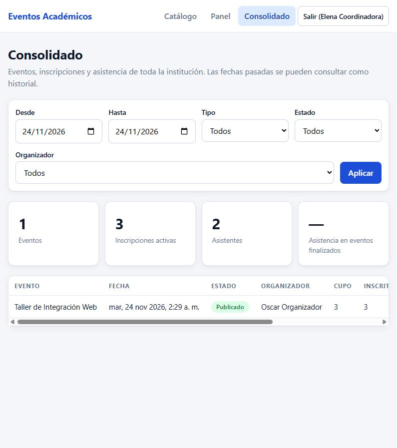
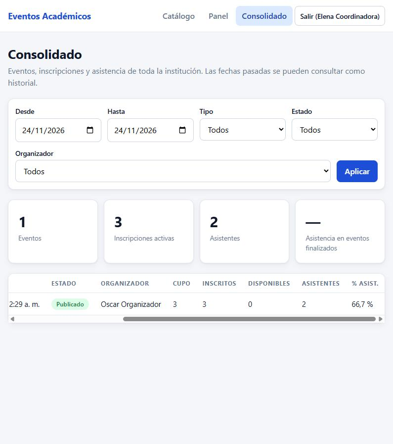
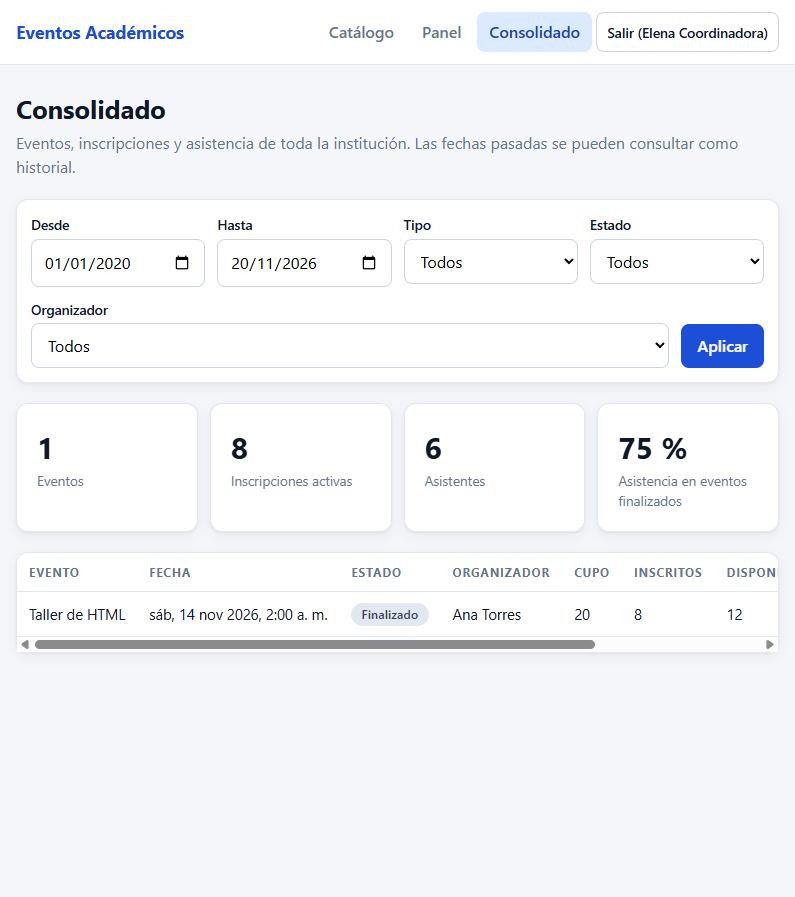

## P12 - Integración interfaz - API - base de datos

- **Requisitos:** CA-01 a CA-06
- **Condiciones iniciales:** las de P01.
- **Pasos:** crear y publicar (P01) → inscribir (P05) → registrar asistencia (P10) → consolidado (P11) → consultar la base de datos.
- **Resultado esperado:** los mismos datos en la interfaz y en la base.
- **Resultado obtenido:** coinciden: 3 inscripciones activas, 2 presentes; los datos rechazados no dejaron rastro.
- **Estado:** Aprobada

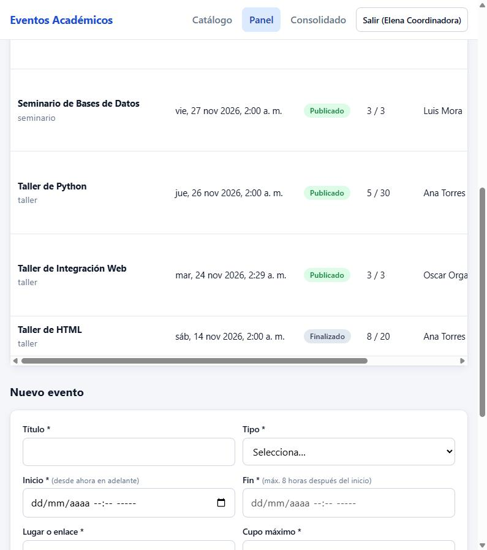
Consulta directa a la base: [P12b_consulta_a_la_base_de_datos.txt](../evidencias/P12b_consulta_a_la_base_de_datos.txt)

---

## Pruebas adicionales

| ID | Prueba | Resultado obtenido | HTTP | Estado | Evidencia |
|---|---|---|---|---|---|
| AD-01 | Correo ya registrado con otro documento | Rechazo por conflicto de identidad | 409 | Aprobada | [captura](../evidencias/EXTRA_conflicto_de_identidad.jpg) |
| AD-02 | Filtro "desde" posterior a "hasta" | Mensaje claro, sin consultar | 422 en la API | Aprobada | [captura](../evidencias/EXTRA_rango_de_fechas_invertido.jpg) |

## Extensiones (constancia y código QR)

| ID | Prueba | Datos | Resultado obtenido | HTTP | Estado | Evidencia |
|---|---|---|---|---|---|---|
| EXT-01 | QR del evento publicado (RF-20) | evento 2 | Imagen QR visible y descargable | 200 | Aprobada | [captura](../evidencias/EXT01_codigo_qr_del_evento.png) |
| EXT-02 | Constancia con asistencia registrada (RF-19) | `laura.gomez@ejemplo.test`, 1000000001 | Constancia con código y QR; imprime en 1 página | 200 | Aprobada | [captura](../evidencias/EXT02_constancia_obtenida.png), [PDF](../evidencias/EXT02_constancia_ejemplo.pdf) |
| EXT-03 | Verificación de una constancia | código emitido | Válida; documento enmascarado | 200 | Aprobada | [captura](../evidencias/EXT03_constancia_verificada.png) |
| EXT-04 | Código manipulado | último carácter cambiado | Rechazado | 404 | Aprobada | [captura](../evidencias/EXT04_codigo_manipulado_rechazado.png) |
| EXT-05 | Inscrito sin asistencia | `daniela.ortiz@ejemplo.test`, 1000000008 | No se emite constancia | 404 | Aprobada | [captura](../evidencias/EXT05_sin_asistencia_no_hay_constancia.png) |

**No verificado:** la lectura del QR con un celular físico. El contenido codificado se comprueba en las pruebas automatizadas (`test_extensiones.py`).
